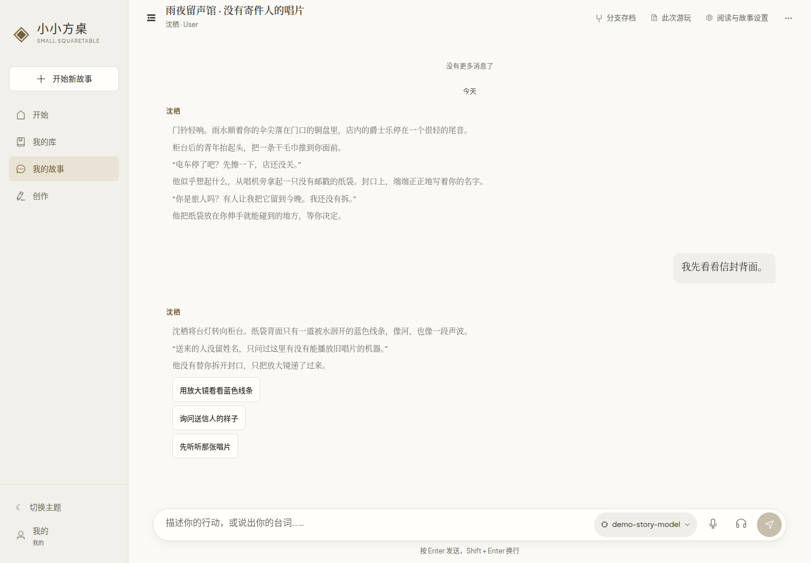
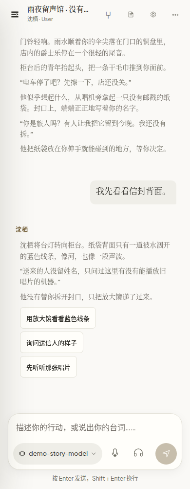
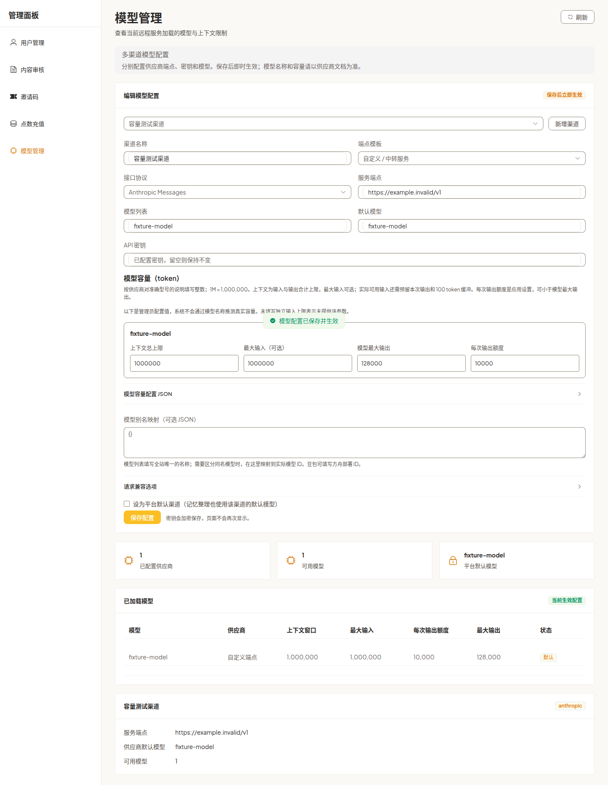
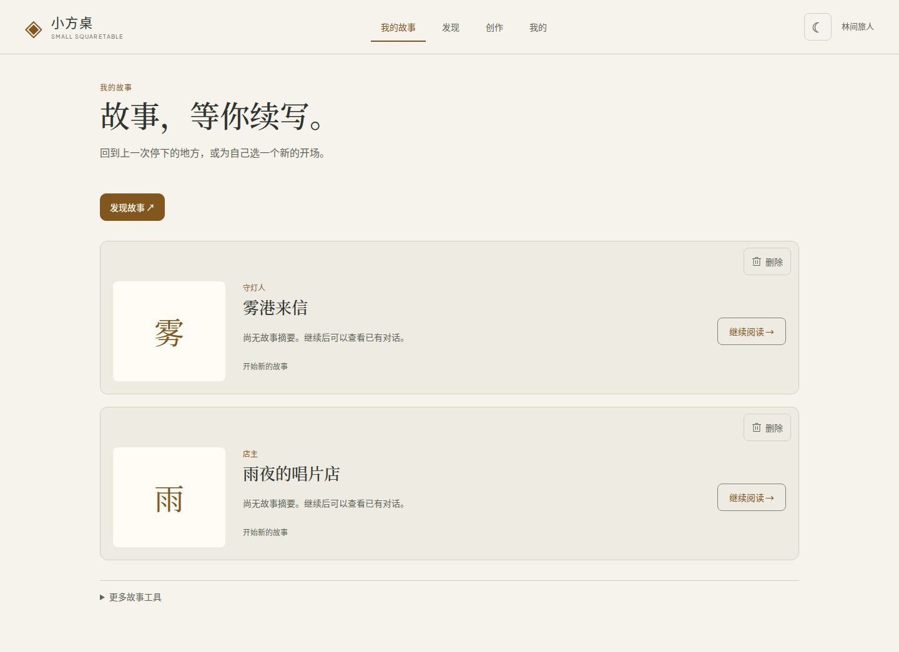
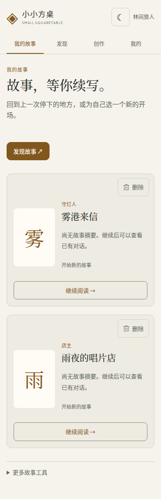

# 小小方桌 Small Squaretable

> 从一张角色卡开始，成为故事中的自己。

小小方桌是一款角色卡驱动的互动故事应用。选择角色与开场，通过推荐行动或自由输入推动剧情，在自己的故事档案中继续上次的经历。我们希望每次选择都能得到认真回应，让人物关系、已发生的事和对话风格逐步形成连续的体验。

**当前阶段：远程内测，尚未完成最终体验验收。** 当前聚焦单人故事，群聊开发暂停。已部署工作台界面、多渠道模型配置及故事阅读功能；真实模型长程体验、逐卡复杂规则和手机真机仍需验收。进度以[当前开发状态](docs/product/current-work.md)为准。

[内测首页](http://47.116.114.103/) · [自建部署](#本机试运行) · [模型配置](#模型接入与管理) · [当前进度](docs/product/current-work.md)

内测注册需要邀请码，由运营者提供。远程实例使用独立数据和运营配置，克隆仓库不会带入账号、故事、密钥或额度授权。当前发现部分页面（包括后台）的直接访问返回404；请先打开首页，通过站内导航进入，深链接恢复仍待修复。

## 体验与能力边界

| 体验 | 当前实现 | 边界 |
| --- | --- | --- |
| 从角色卡开始 | 发现角色、私人角色库、开场选择与身份设置 | 导入成功不代表原卡全部机制可运行 |
| 探索式对话 | 开局与每轮回复推荐、自由输入、流式回复；推荐竖排紧贴正文 | 推荐不等于原卡规则；仅依据受支持规则提交状态，异常或中断轮次不能冒充已执行行动 |
| 故事工作台 | 可收起导航、宽幅阅读区、统一输入栏和模型选择；资料、分支与设置按需打开 | 覆盖式抽屉带暗幕并暂时阻止正文操作；移动浏览器验证不等于手机真机验收 |
| 状态与地图 | 展示有依据的状态、已知地点、历程和规则行动 | 按卡片的受支持规则呈现，不为缺少设定的卡虚构地图、资产或奖励 |
| 连续故事 | 故事独立记忆、设定快照、阅读恢复、纠正与分支 | 不承诺无限记忆或模型永不遗忘；长程叙事质量仍需验证 |
| 创作与导入 | PNG/JSON 角色卡、世界书、编辑预览及有限适配工作流 | 世界书按明确绑定使用；复杂第三方脚本与持续规则不保证等价转换 |
| 故事管理 | 继续原档、同卡另开故事、卡片右上角确认删除 | 删除的是选中的故事存档，不是来源角色卡 |
| 后台管理 | 用户列表、邀请码、点数和模型渠道管理；容量参数可编辑并持久保存 | 需要管理员权限；供应商模板不代表所有模型均已实测 |

仍在推进：更多第三方规则适配、逐卡长程体验、真实模型纠正续写、偶发故障排查，以及人工视觉与手机真机验收。见[活动待办](docs/product/backlog.md)。支持预付点数和显式授权的免扣点策略，平台日额度独立配置；免扣点不代表供应商调用免费。在线支付和正式公网运营尚未完成。

## 模型接入与管理

管理员登录后，通过站内导航进入「后台 → 模型管理」，可新增独立渠道，编辑协议、端点、密钥、模型列表、默认模型、别名和请求兼容参数。支持 **OpenAI Chat Completions 兼容、Anthropic Messages、Gemini 原生**三种协议；提供多个供应商端点模板，具体可用模型以账号权限及供应商文档为准。

每个模型可分别填写：

| 参数 | 用途 |
| --- | --- |
| 上下文总上限 | 限定输入与预留输出的总空间 |
| 最大输入（可选） | 供应商另有独立输入限制时填写，未公布则留空 |
| 模型最大输出 | 供应商公布的输出能力 |
| 每次输出额度 | 本项目每次请求的输出预算，不等于模型能力或实际用量 |

保存后即时生效；聊天页进入或打开模型选择器时刷新可用列表。已有故事不会因切换平台默认渠道而自动改写已选模型。密钥加密持久化，后台只显示是否已配置，留空保留当前渠道密钥。

Docker 部署须持久挂载 `/app/config`，并保留用于加密的 `TOTP_ENCRYPTION_KEY`；仓库的 `compose.beta.yml` 已配置独立模型配置卷。不要将运行时配置或密钥上传到 Git。详见[多渠道接入步骤](docs/deployment/model-channels-20261031.md)和[容量字段及规格依据](docs/deployment/model-capacity-settings-20261101.md)。

当前接入范围是文本故事对话；图片、音频、工具调用和 OpenAI Responses API 尚未接入。协议适配与模型列表可用不代表剧情结构、推荐、记忆及极限容量已经通过真实模型验收。

## 页面截图

以下图片均为浏览器实际渲染的产品页面，不是生成图片或设计稿。**截图中的故事与账号使用测试数据，不代表真实用户记录或真实模型叙事质量。**

### 当前工作台与模型管理

2026-11-01，当前源码生产构建的浏览器截图，使用隔离接口与演示账号；容量数字用于演示编辑，并非某个供应商的规格承诺。



<details>
<summary>查看当前手机布局</summary>



</details>

<details>
<summary>查看模型容量管理</summary>



</details>

### 我的故事：历史删除入口截图

2026-10-29，3081内测部署构建的浏览器截图；业务接口使用测试替身。每张故事卡片右上角提供独立删除按钮，点击后确认，失败保留卡片供重试。



<details>
<summary>查看手机页面</summary>



</details>

### 发现角色

下图为 2026-10-25 正式构建在隔离验证环境中的历史截图，用于展示角色发现布局；不代表当前版本的全部细节。[截图来源与验证边界](docs/design/exploration-07ac-integration/README.md)。


## 本机试运行

建议先采用独立的 Docker 内测环境。需要 Git、Node.js 22、Docker Engine 和 Docker Compose v2；Compose 提供 PostgreSQL 15 / pgvector 和 Redis 7。

以下流程适用于**全新安装与空数据库卷**。已有实例先备份并按[部署与恢复说明](docs/deployment/beta-release.md)操作，不重新初始化账号或删除数据卷。

```bash
git clone https://github.com/FanYin1/Small-Squaretable.git
cd Small-Squaretable
npm ci
node scripts/beta-config.mjs
```

配置生成器会创建私有 `.env.beta` 并拒绝覆盖已有文件。私下编辑配置，填写初始模型端点、密钥和模型名称，检查每日用量上限。首次管理员就绪后也可从后台管理模型；旧环境变量初始化方式见[模型容量说明](docs/deployment/custom-model-capacity.md)，Gemini 接口见[供应商接入说明](docs/deployment/gemini-provider-integration.md)。

```bash
docker compose --env-file .env.beta -f compose.beta.yml config --quiet
docker compose --env-file .env.beta -f compose.beta.yml build app
docker compose --env-file .env.beta -f compose.beta.yml up -d
curl --fail http://127.0.0.1:3080/health/ready
```

默认访问 `http://localhost:3080`，仅绑定本机；远程实例的端口和反向代理由部署者单独配置。Compose 在启动应用前执行 beta 迁移。首次使用还需按[内测部署说明](docs/deployment/beta-release.md#第一个运营账号)生成邀请码、注册和初始化运营账号，再导入角色卡并配置点数。模型与邮件服务由部署者自行配置；健康检查通过不代表模型可生成或邮件可发送。

`PLATFORM_DAILY_TOKEN_LIMIT` 在生产环境必须显式配置；正数设置平台每日 token 上限，`-1` 显式允许不限量并继续记录用量。`NEW_ACCOUNT_UNLIMITED_CREDITS=true` 可为后续新注册账号启用免扣点，默认关闭；不会批量修改既有账号。两者与单个模型容量、每次输出预算相互独立，详见[额度策略](docs/deployment/unlimited-credits-20261030.md)。

可导入仓库自带的[雨夜唱片店示例卡](docs/product/examples/rainy-record-shop.json)开始体验，不包含第三方私人角色卡或用户存档。

## 开发与验证

前端采用 Vue 3、Vite、TypeScript、Pinia 和 Element Plus；后端采用 Node.js、Hono、Drizzle ORM、PostgreSQL / pgvector 和 Redis。角色适配相关依赖包含 LangChain / LangGraph，当前能力仍受上述适配范围限制。

仓库保留 Stripe、Kafka、Flink、ClickHouse 等历史与可选模块，它们不是本机故事内测的必需服务，也不代表当前全部启用。

```bash
npm ci
npm run type-check
npm run build
```

本地开发须单独配置 `.env`，使数据库、Redis、认证和模型设置指向开发环境。前后端分别启动：

```bash
npm run dev          # 后端，默认 3000
npm run dev:client   # 前端，默认 5173，代理 API 和 WebSocket
```

数据库初始化参照上述 beta 空库流程与部署文档；不要直接对存量业务库套用基线。`db:migrate:beta` 依赖 `dist/server/migrate.js`，在宿主机运行前须先执行 `npm run build:server`。旧迁移目录与 beta 基线有不同适用范围。

常用验证命令：

```bash
npx vitest run src/client/components/chat/StorySaveCard.spec.ts
npx playwright test -c playwright.story.config.ts
npm run lint
```

组件测试、受控接口的浏览器测试、真实模型验证和真机验收分别报告。历史测试数量不作为当前版本通过率或完成度。

当前工作台截图可在完成构建并启动 `npx vite preview --host 127.0.0.1 --port 5197` 后，运行 `node scripts/readme-screenshots.mjs` 复现；它仅使用仓库示例卡与隔离接口，不连接真实模型。此次仓库整理的验证结果见[同步记录](docs/deployment/github-sync-20261101.md)。

## 文档导航

- [当前开发状态](docs/product/current-work.md)：现状、开放工作包与验收边界。
- [产品体验基线](docs/product/exploration-experience-baseline.md)：已确认的产品决策。
- [开发计划](docs/product/story-development-plan.md)与[活动待办](docs/product/backlog.md)。
- [角色卡格式](docs/deployment/character-card-formats.md)与[世界书绑定](docs/deployment/worldbook-bindings.md)。
- [本机部署](docs/deployment/beta-release.md)与[探索候选历史验收](docs/deployment/exploration-candidate.md)。历史镜像不作为当前运行版本的证明。
- [远程部署与入口](docs/deployment/remote-entry-20261029.md)、[多渠道模型配置](docs/deployment/model-channels-20261031.md)、[模型容量](docs/deployment/model-capacity-settings-20261101.md)。
- [宽幅故事工作台](docs/deployment/workbench-canvas-delivery-20261031.md)、[推荐行动布局](docs/deployment/inline-story-actions-20261031.md)、[登录续期修复](docs/deployment/auth-session-recovery-20261101.md)。
- [历史工程路线图](ROADMAP.md)：早期平台建设记录，不代表当前故事体验已全部验收。
- [贡献指南](CONTRIBUTING.md)与[协作规则](AGENTS.md)。

## 许可证

历史工程说明标注为 MIT，但仓库目前没有独立的 LICENSE 文件，具体授权文本仍需维护者补充确认。
