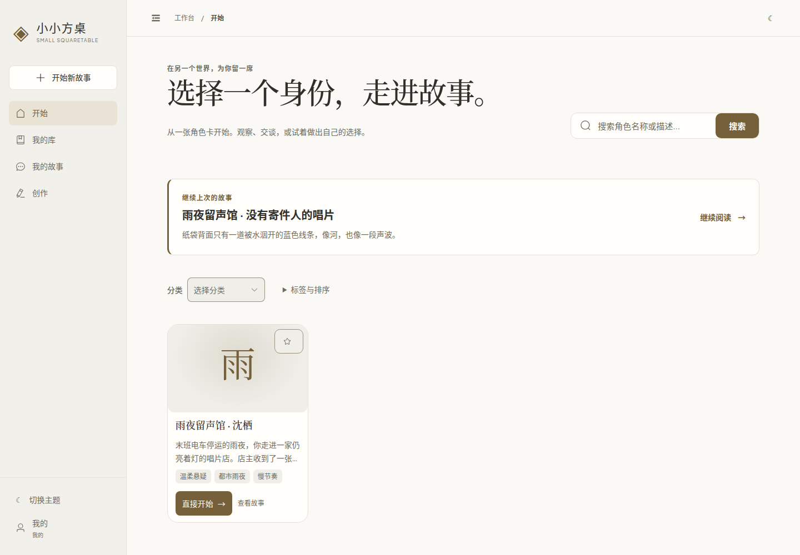
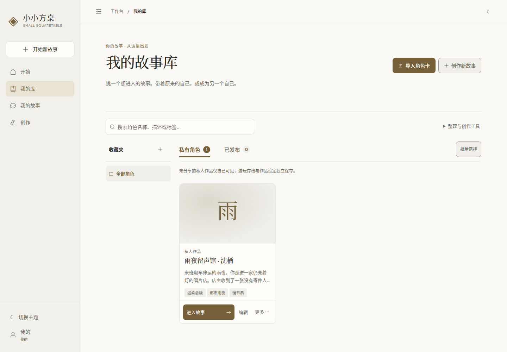
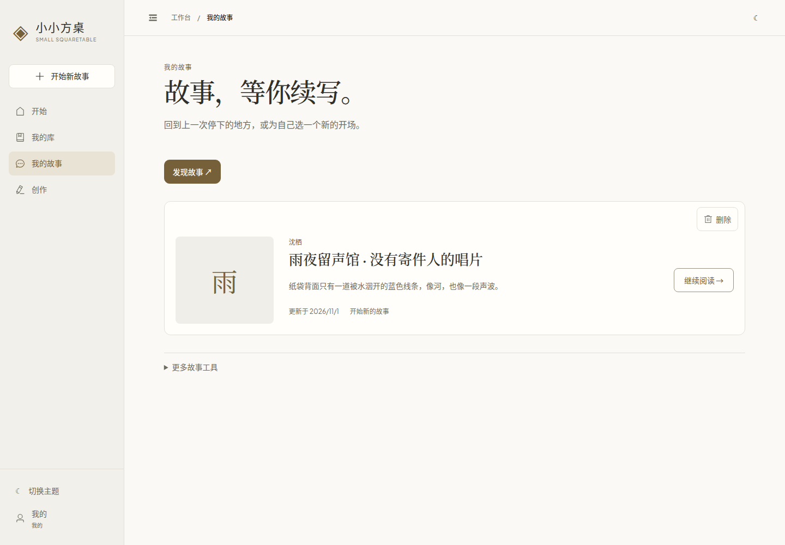
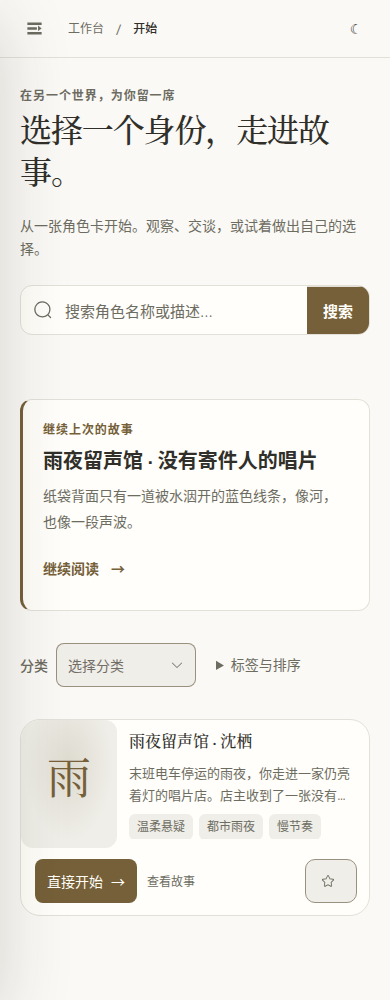
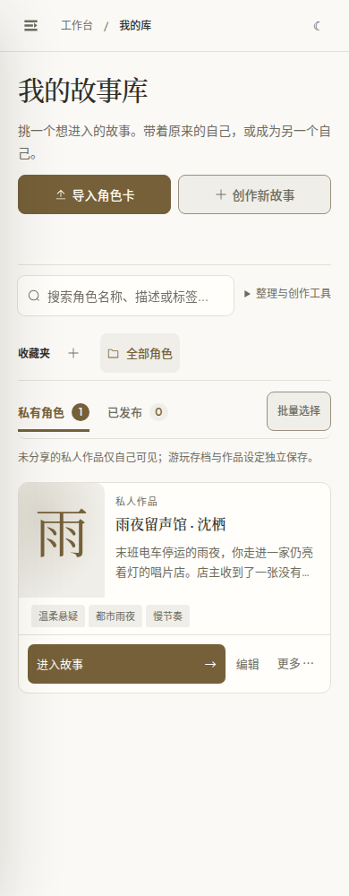
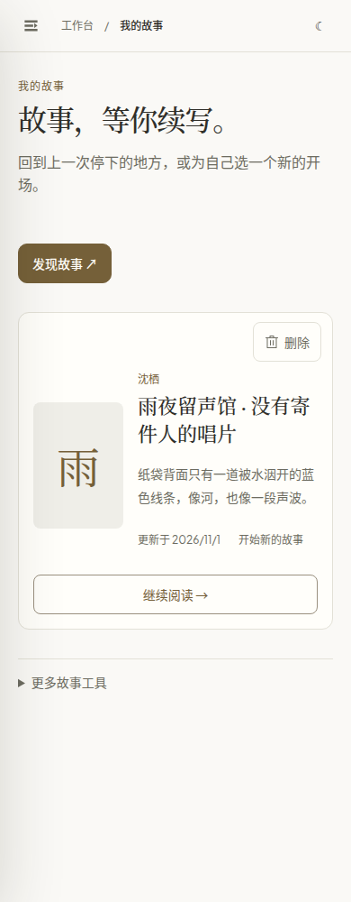

# 小小方桌 Small Squaretable

> 从一张角色卡开始，成为故事中的自己。

小小方桌是一款以对话为中心的互动故事工作台。选择或导入角色卡，决定开场与自己的身份，通过推荐行动或自由输入推进故事，再从存档中继续上次的经历。角色发现、私人角色库、故事存档和创作共用一个工作台，阅读与输入占据主要空间。

**当前阶段：远程内测，尚未完成最终体验验收。** 当前聚焦单人故事，群聊开发暂停。已部署工作台界面、多渠道模型配置及故事阅读功能；真实模型长程体验、逐卡复杂规则和手机真机仍需验收。进度以[当前开发状态](docs/product/current-work.md)为准。

[内测首页](http://47.116.114.103/) · [自建部署](#本机试运行) · [模型配置](#模型接入与管理) · [当前进度](docs/product/current-work.md)

内测注册的邀请码目前为选填，仍须完成成年声明。远程实例使用独立数据和运营配置，克隆仓库不会带入账号、故事、密钥或额度授权。页面深链接支持浏览器直接访问；后台仍需管理员权限。


*2026-11-01 生产构建的浏览器实拍，使用仓库示例故事与隔离接口。对白和推荐为预写演示，不是模型实测记录。*

## 在工作台中做什么

| 入口 | 当前体验 |
| --- | --- |
| 开始 | 搜索与筛选公开角色卡，预览故事、选择开场，也可继续最近的故事 |
| 我的库 | 导入 PNG / JSON 角色卡，管理私人作品、收藏夹和已发布角色，进入故事或编辑作品 |
| 我的故事 | 管理已经开始的故事存档；继续阅读、同卡另开故事，或从卡片右上角确认删除存档 |
| 故事对话 | 流式正文、开局与每轮回复后的竖排推荐、自由输入，以及输入栏内的模型选择 |
| 资料与阅读工具 | 阅读设置保留阅读偏好；更多 → 故事工具中查看记忆、置顶、请求诊断和兼容范围；覆盖式抽屉带暗幕 |
| 创作 | 编辑角色、开场与世界书绑定，预览单本触发；新故事冻结设定，已有故事不静默覆盖 |
| 后台 | 管理用户、邀请码、点数和模型渠道，直接编辑模型容量与请求参数 |

桌面导航可以收起；手机使用覆盖式导航。角色卡采用紧凑布局，故事对话保留宽幅正文，推荐紧贴回复下方。私人角色作品与游玩存档分别保存，删除存档不会删除来源角色卡。

故事支持独立记忆、设定快照、阅读恢复、纠正与分支；状态、地图和规则行动按卡片的受支持内容呈现。**导入成功不代表原卡的全部规则可以执行**：复杂第三方脚本不保证等价转换，世界书只按明确绑定使用，异常或中断轮次不视为已执行行动。

真实模型长程叙事、逐卡规则适配、记忆与纠正续写、人工视觉和手机真机仍在验收中，见[活动待办](docs/product/backlog.md)。支持预付点数和显式授权的免扣点策略，平台日额度独立配置；在线支付和正式运营准备尚未完成。

## 请求诊断与生成边界

聊天页通过「更多 → 故事工具 → 诊断与兼容 → 本轮上下文诊断」查看实际请求的来源、消息顺序、历史取舍、记忆与世界书选入及容量估算。诊断只对故事所有者可见，最多保留最近 10 次、每条 24 小时；不保存原始提示词或密钥，不代表模型回复已成功保存。

同一入口的「生成结果与错误回溯」提供阶段耗时、错误码、HTTP 状态、结构校验位置和关联消息，可导出单轮诊断。执行记录按故事保留最近 30 条、每条 7 天；流程失败与剧情是否已经保存分别显示。不保存完整响应原文，进程崩溃或存储故障可能缺记录，旧错误不会补造。详见[错误回溯说明](docs/product/generation-error-trace-20261106.md)。

世界书编辑器的「单本触发预览」使用已保存内容和测试文本，不等同于故事的真实请求。模型输出仍经过完整性、结构和状态校验；有界格式兼容与流结束保护不能保证任意模型永不出错，也不会自动重放失败轮次。

四包范围与验收记录见[世界书兼容](docs/product/worldbook-compatibility-work-package-20261105.md)、[请求诊断](docs/product/prompt-trace-work-package-20261105.md)、[单轮可靠性](docs/product/single-turn-reliability-work-package-20261105.md)和[界面整理](docs/product/player-author-interface-work-package-20261105.md)。

## 模型接入与管理

管理员登录后，通过站内导航进入「后台 → 模型管理」，可新增独立渠道，编辑协议、端点、密钥、模型列表、默认模型、别名和请求兼容参数。支持 **OpenAI Chat Completions 兼容、Anthropic Messages、Gemini 原生**三种协议；提供多个供应商端点模板，具体可用模型以账号权限及供应商文档为准。

每个模型可分别填写：

| 参数 | 用途 |
| --- | --- |
| 上下文总上限 | 限定输入与预留输出的总空间 |
| 最大输入（可选） | 供应商另有独立输入限制时填写，未公布则留空 |
| 模型最大输出 | 供应商公布的输出能力 |
| 每次输出额度 | 本项目每次请求的输出预算，不等于模型能力或实际用量 |

保存后即时生效；聊天页进入或打开模型选择器时刷新可用列表。已有故事不会因切换平台默认渠道而自动改写已选模型。密钥加密持久化，后台只显示是否已配置，留空保留当前渠道密钥。

Docker 部署须持久挂载 `/app/config`，并保留用于加密的 `TOTP_ENCRYPTION_KEY`；仓库的 `compose.beta.yml` 已配置独立模型配置卷。不要将运行时配置或密钥上传到 Git。详见[多渠道接入步骤](docs/deployment/model-channels-20261031.md)和[容量字段及规格依据](docs/deployment/model-capacity-settings-20261101.md)。

当前接入范围是文本故事对话；图片、音频、工具调用和 OpenAI Responses API 尚未接入。协议适配与模型列表可用不代表剧情结构、推荐、记忆及极限容量已经通过真实模型验收。

## 当前页面

以下为 **2026-11-01 源码生产构建**的浏览器截图（后续工具入口调整以当前进度文档为准），使用仓库自有的「雨夜留声馆」示例卡、演示账号和隔离接口。截图展示实际界面，不包含真实用户记录；模型容量数字仅用于演示编辑。

### 开始：发现角色与继续故事



### 我的库：私人角色作品



### 我的故事：继续与管理存档



<details>
<summary>查看手机布局：发现、私人库、存档与对话</summary>








</details>

<details>
<summary>查看后台模型管理</summary>


</details>

## 本机试运行

建议先采用独立的 Docker 内测环境。需要 Git、Node.js 22、Docker Engine 和 Docker Compose v2；Compose 提供 PostgreSQL 15 / pgvector 和 Redis 7。

以下流程适用于**全新安装与空数据库卷**。已有实例先备份并按[部署与恢复说明](docs/deployment/beta-release.md)操作，不重新初始化账号或删除数据卷。

```bash
git clone https://github.com/FanYin1/Small-Squaretable.git
cd Small-Squaretable
npm ci
node scripts/beta-config.mjs
```

配置生成器会创建私有 `.env.beta` 并拒绝覆盖已有文件。私下编辑配置，填写初始模型端点、密钥和模型名称，检查每日用量上限。首次管理员就绪后也可从后台管理模型；旧环境变量初始化方式见[模型容量说明](docs/deployment/custom-model-capacity.md)，Gemini 接口见[供应商接入说明](docs/deployment/gemini-provider-integration.md)。

```bash
docker compose --env-file .env.beta -f compose.beta.yml config --quiet
docker compose --env-file .env.beta -f compose.beta.yml build app
docker compose --env-file .env.beta -f compose.beta.yml up -d
curl --fail http://127.0.0.1:3080/health/ready
```

默认访问 `http://localhost:3080`，仅绑定本机；远程实例的端口和反向代理由部署者单独配置。Compose 在启动应用前执行 beta 迁移。首次使用还需注册并按[内测部署说明](docs/deployment/beta-release.md#第一个运营账号)初始化运营账号，再导入角色卡并配置点数；注册邀请码现为选填，旧部署文档中的必填说明属于历史行为。模型与邮件服务由部署者自行配置；健康检查通过不代表模型可生成或邮件可发送。

`PLATFORM_DAILY_TOKEN_LIMIT` 在生产环境必须显式配置；正数设置平台每日 token 上限，`-1` 显式允许不限量并继续记录用量。`NEW_ACCOUNT_UNLIMITED_CREDITS=true` 可为后续新注册账号启用免扣点，默认关闭；不会批量修改既有账号。两者与单个模型容量、每次输出预算相互独立，详见[额度策略](docs/deployment/unlimited-credits-20261030.md)。

可导入仓库自带的[雨夜留声馆示例卡](docs/product/examples/rainy-record-shop.json)开始体验，不包含第三方私人角色卡或用户存档。

## 开发与验证

前端采用 Vue 3、Vite、TypeScript、Pinia 和 Element Plus；后端采用 Node.js、Hono、Drizzle ORM、PostgreSQL / pgvector 和 Redis。角色适配相关依赖包含 LangChain / LangGraph，当前能力仍受上述适配范围限制。

```bash
npm ci
npm run type-check
npm run build
```

本地开发须单独配置 `.env`，使数据库、Redis、认证和模型设置指向开发环境。前后端分别启动：

```bash
npm run dev          # 后端，默认 3000
npm run dev:client   # 前端，默认 5173，代理 API 和 WebSocket
```

数据库初始化参照上述 beta 空库流程与部署文档；不要直接对存量业务库套用基线。`db:migrate:beta` 依赖 `dist/server/migrate.js`，在宿主机运行前须先执行 `npm run build:server`。旧迁移目录与 beta 基线有不同适用范围。

常用验证命令：

```bash
npx vitest run src/client/components/chat/StorySaveCard.spec.ts
npx playwright test -c playwright.story.config.ts
npm run lint
```

组件测试、受控接口的浏览器测试、真实模型验证和真机验收分别报告。历史测试数量不作为当前版本通过率或完成度。

发现页、私人库、故事存档和对话截图可在完成构建并启动 `npx vite preview --host 127.0.0.1 --port 5197` 后，运行 `node scripts/readme-screenshots.mjs` 复现；脚本覆盖桌面 1440px 与手机 390px，仅使用仓库示例卡与隔离接口，不连接真实模型。模型管理截图的复现方式及验证记录见[同步记录](docs/deployment/github-sync-20261101.md)。

## 文档导航

- [当前开发状态](docs/product/current-work.md)：现状、开放工作包与验收边界。
- [产品体验基线](docs/product/exploration-experience-baseline.md)：已确认的产品决策。
- [活动待办](docs/product/backlog.md)：尚未完成的工作与验收项。
- [角色卡格式](docs/deployment/character-card-formats.md)与[世界书绑定](docs/deployment/worldbook-bindings.md)。
- [本机部署与恢复](docs/deployment/beta-release.md)。
- [远程部署与入口](docs/deployment/remote-entry-20261029.md)、[多渠道模型配置](docs/deployment/model-channels-20261031.md)、[模型容量](docs/deployment/model-capacity-settings-20261101.md)。
- [宽幅故事工作台](docs/deployment/workbench-canvas-delivery-20261031.md)、[推荐行动布局](docs/deployment/inline-story-actions-20261031.md)、[登录续期修复](docs/deployment/auth-session-recovery-20261101.md)。
- [贡献指南](CONTRIBUTING.md)与[协作规则](AGENTS.md)。

## 许可证

历史工程说明标注为 MIT，但仓库目前没有独立的 LICENSE 文件，具体授权文本仍需维护者补充确认。
