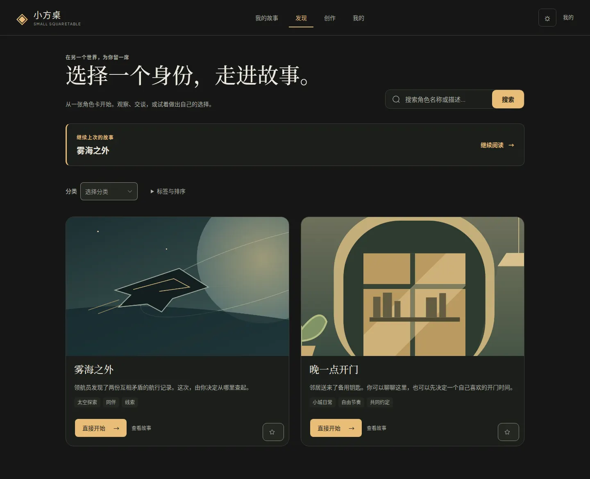
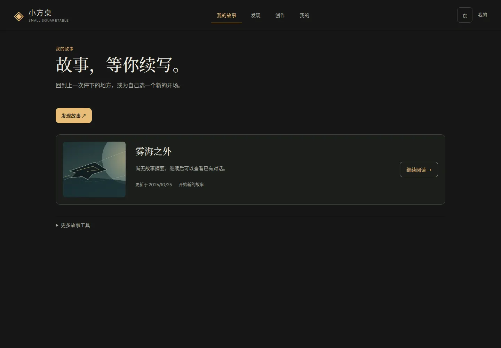
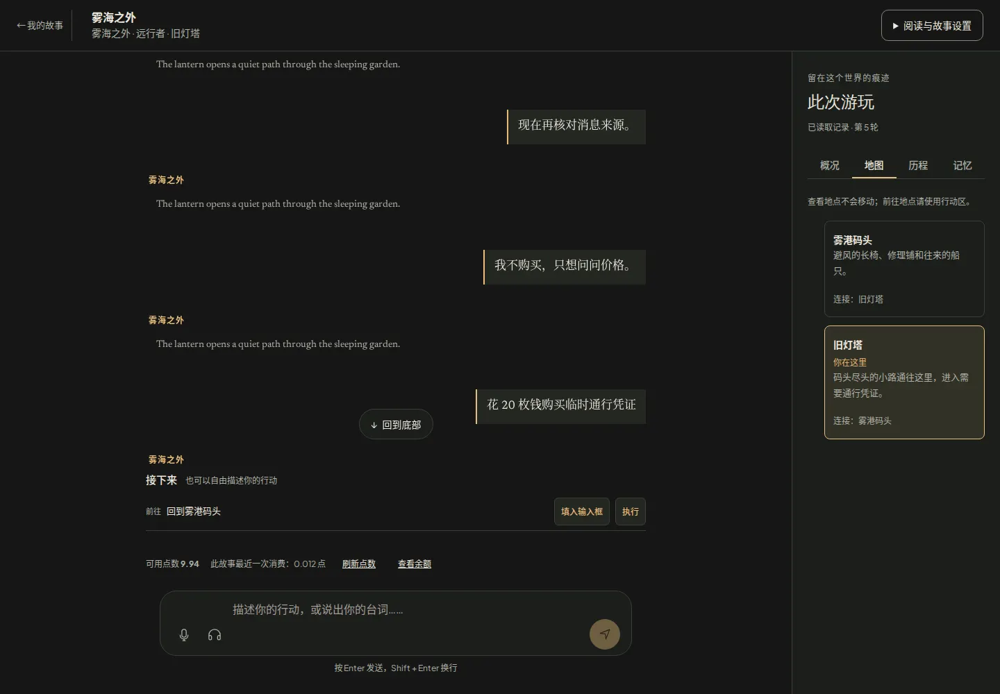

# 小方桌 Small Squaretable

> 从一张角色卡开始，走进一段可以由你推动、也能在下次继续的故事。

小方桌是一款角色卡驱动的互动故事应用。选择角色与开场后，你可以通过推荐行动或自由输入探索剧情；故事会保留重要状态与游玩记忆，让人物、地点和已经发生的事在多轮对话中保持连续。

角色卡负责人物与故事设定，世界书可以补充人物、概念和常识。进入故事时会沿用角色卡已有设定，不要求用户先理解复杂配置。产品仍在积极开发中，部分卡片规则和状态适配能力尚有限，详见[当前开发状态](docs/product/current-work.md)。

## 产品实机

以下为产品页面的实际浏览器截图，展示角色发现、故事库和故事对话界面。

### 发现角色



### 我的故事



### 故事对话



## 项目概述

项目面向喜欢角色扮演与互动叙事的用户，重点探索快速进入故事、逐步推动剧情、保留世界状态，以及离开后延续同一段体验。产品决策、已交付能力与待验收事项见[产品体验基线](docs/product/exploration-experience-baseline.md)、[当前工作](docs/product/current-work.md)和[活动待办](docs/product/backlog.md)。

## 开发必读

- [产品决策与讨论纪要](docs/product/exploration-experience-baseline.md)：已确认、推导约束和待讨论项。
- [主开发计划](docs/product/story-development-plan.md) 与 [活动待办](docs/product/backlog.md)：当前工作与验收映射。
- [正式实施计划](docs/product/exploration-implementation-plan.md)：七页生产落点、接口依赖、分批顺序与验收标准。
- [七页示例](docs/design/exploration-demo/README.md) 与 [开发参考快照](docs/design/exploration-baseline/README.md)：获准使用的开发参考，包含源码归档、画面及校验命令。
- [页面参考与讨论稿](docs/design/exploration-page-proposal.md)：保留研究来源、推导及尚未定案的交互。
- [R5 验收记录](docs/deployment/frontend-r5-acceptance.md)：已部署版本、验证证据与未签收项。
- [探索候选验收记录](docs/deployment/exploration-candidate.md)：当前3081入口、真实数据恢复、检查证据和剩余验收条件；取代历史记录作为当前交付入口。
- [仓库协作规则](AGENTS.md)：后续任务如何保留决策与验收边界。

以下阶段百分比、技术栈、功能和测试数来自旧工程说明，保留用于追溯；不是当前生产能力、发布进度或新体验完成率。当前结论以上述文档为准。

## 历史工程状态

```
Phase 1-7: 基础设施 → 生产部署    ████████████████████ 100% ✅
迭代 1-6: 高级功能 + 生产就绪      ████████████████████ 100% ✅
迭代 7-14: 测试/i18n/安全/UI重构   ████████████████████ 100% ✅
迭代 15-24: 多模态/社交/创作工具    ████████████████████ 100% ✅
迭代 25-32: AI增强/性能/导入导出    ████████████████████ 100% ✅
```

## 技术栈

| 层级 | 技术 |
|------|------|
| 前端 | Vue 3 + Vite 7 + TypeScript + Element Plus |
| 后端 | Hono.js + Node.js |
| 数据库 | PostgreSQL + Drizzle ORM + pgvector |
| 缓存 | Redis 5 |
| 认证 | JWT 双 Token + OAuth2 (Google/GitHub) + TOTP 2FA |
| 支付 | Stripe (三层订阅) |
| 事件管道 | Kafka 3.7 (KRaft) |
| 流处理 | Apache Flink 1.19 (Java 17) |
| 分析 | ClickHouse 24.3 + ECharts |
| ML | Transformers.js (嵌入 + 情感分析) |
| 测试 | Vitest 4 (2017 通过) + Playwright (228 E2E) |
| 部署 | Docker + Kubernetes + CI/CD |

## 功能特性

### 核心平台
- **多租户架构** — 完整的租户隔离和数据安全
- **订阅系统** — Stripe 三层计划 (Free/Pro/Team)，用量跟踪
- **认证系统** — JWT 双 Token + OAuth2 (Google/GitHub) + TOTP 2FA + 邮箱验证
- **RBAC 权限** — user/moderator/admin 角色层级，管理后台

### AI 聊天
- **实时聊天** — WebSocket + LLM 流式响应，消息分支/编辑/回滚
- **多角色聊天** — 群聊支持多角色轮流/全部/随机策略
- **智能角色系统** — pgvector 语义记忆检索 + 2D 情感状态机 + 调试面板
- **世界书系统** — 四层作用域，关键词+语义混合触发，SillyTavern 格式兼容
- **语音/音频** — TTS 朗读 + 音频消息录制播放
- **Markdown 渲染** — highlight.js 代码高亮 + KaTeX 数学公式

### 角色市场
- **角色市场** — 社区分享、五维度评分、收藏/评论
- **角色创作** — 模板系统、版本历史、协作编辑、表情精灵
- **导入导出** — SillyTavern V2 PNG/JSON 导入，批量导入导出
- **推荐引擎** — 趋势/协同/内容三策略混合推荐 + A/B 测试

### 社区与生态
- **社交功能** — 关注/收藏/评论/通知 + @提及
- **开发者 API** — API Key 管理 + 速率限制 + Webhook
- **插件系统** — Worker Thread 沙箱隔离，KV 存储，事件管道
- **数据分析** — Kafka → Flink → ClickHouse 实时分析管道 + 管理仪表盘

### 平台质量
- **国际化** — 中英文全覆盖 (~490 locale 键)
- **安全加固** — CSRF + CSP + 速率限制 + Zod 输入验证 + 文件上传鉴权
- **PWA** — 离线支持 + A2HS 安装提示 + 多设备同步
- **移动端适配** — 响应式布局 + 底部导航栏 + 滑动手势
- **性能优化** — 代码分割 + SWR 缓存 + 数据库索引优化

## 快速开始

### 环境要求
- Node.js >= 20
- PostgreSQL >= 15 (with pgvector)
- Redis >= 7

### 安装

```bash
git clone https://github.com/FanYin1/Small-Squaretable.git
cd Small-Squaretable
npm install

# 配置环境变量
cp .env.example .env

# 数据库迁移
npm run db:migrate
```

### 启动开发服务器

```bash
npm run dev              # 后端 (http://localhost:3000)
npm run dev:client       # 前端 (http://localhost:5173)
```

### 常用命令

```bash
npm run test             # 单元测试 (Vitest)
npx playwright test      # E2E 测试
npm run build            # 生产构建
npm run db:studio        # Drizzle Studio
npm run lint:fix         # 代码检查修复
```

## 项目结构

```
Small-Squaretable/
├── src/
│   ├── client/              # Vue 3 前端
│   │   ├── components/      # UI 组件 (chat, character, debug, layout, analytics...)
│   │   ├── pages/           # 页面组件
│   │   ├── stores/          # Pinia 状态管理
│   │   ├── services/        # API 服务层
│   │   ├── composables/     # Vue Composables
│   │   └── i18n/            # 国际化 (en-US, zh-CN)
│   ├── server/              # Hono.js 后端
│   │   ├── routes/          # API 路由 (20+ 模块)
│   │   ├── services/        # 业务逻辑 (30+ 服务)
│   │   ├── middleware/      # 中间件 (auth, csrf, rate-limit, feature-gate)
│   │   └── jobs/            # 定时任务 (GDPR, 清理, 审计)
│   ├── db/                  # 数据库 (26 张表, Drizzle ORM)
│   ├── core/                # 共享核心 (redis, kafka, clickhouse, config)
│   └── types/               # TypeScript 类型定义
├── flink-jobs/              # Flink 流处理作业 (Java 17)
├── clickhouse/              # ClickHouse 分析库 Schema
├── ml-service/              # ML 微服务 (嵌入 + 情感分析)
├── e2e/                     # Playwright E2E 测试
├── k8s/                     # Kubernetes 配置
├── scripts/                 # 工具脚本
└── docs/                    # 文档 (API, 部署, 监控)
```

## 技术指标

| 指标 | 数值 |
|------|------|
| 单元测试 | 2017 通过, 0 失败 |
| E2E 测试 | 228 tests, 17 spec 文件 |
| API 端点 | 154 (OpenAPI 3.1.0 文档化) |
| 数据库表 | 26 (PostgreSQL) + 8 (ClickHouse) |
| i18n 覆盖 | 86 Vue 文件, ~490 locale 键 |
| Kafka Topics | 5 |
| Flink 作业 | 6 |

## 部署

### Docker

```bash
./scripts/docker-build.sh -e prod --scan
docker-compose up -d
```

### Kubernetes

```bash
./scripts/deploy-k8s.sh -k -e production
kubectl get pods -n small-squaretable
```

详见 [部署指南](docs/deployment/deployment-guide.md)。

## 文档

| 文档 | 说明 |
|------|------|
| [ROADMAP.md](ROADMAP.md) | 开发路线图 (32 次迭代详情) |
| [USER_GUIDE.md](USER_GUIDE.md) | 用户使用指南 |
| [API_USAGE_GUIDE.md](API_USAGE_GUIDE.md) | API 接口文档 |
| [CONTRIBUTING.md](CONTRIBUTING.md) | 贡献指南 |
| [OPERATIONS_MANUAL.md](OPERATIONS_MANUAL.md) | 运维手册 |
| [docs/api/openapi.yaml](docs/api/openapi.yaml) | OpenAPI 3.1.0 规范 (154 端点) |

## 许可证

MIT License

## 贡献

欢迎提交 Issue 和 Pull Request！请先阅读 [贡献指南](CONTRIBUTING.md)。
