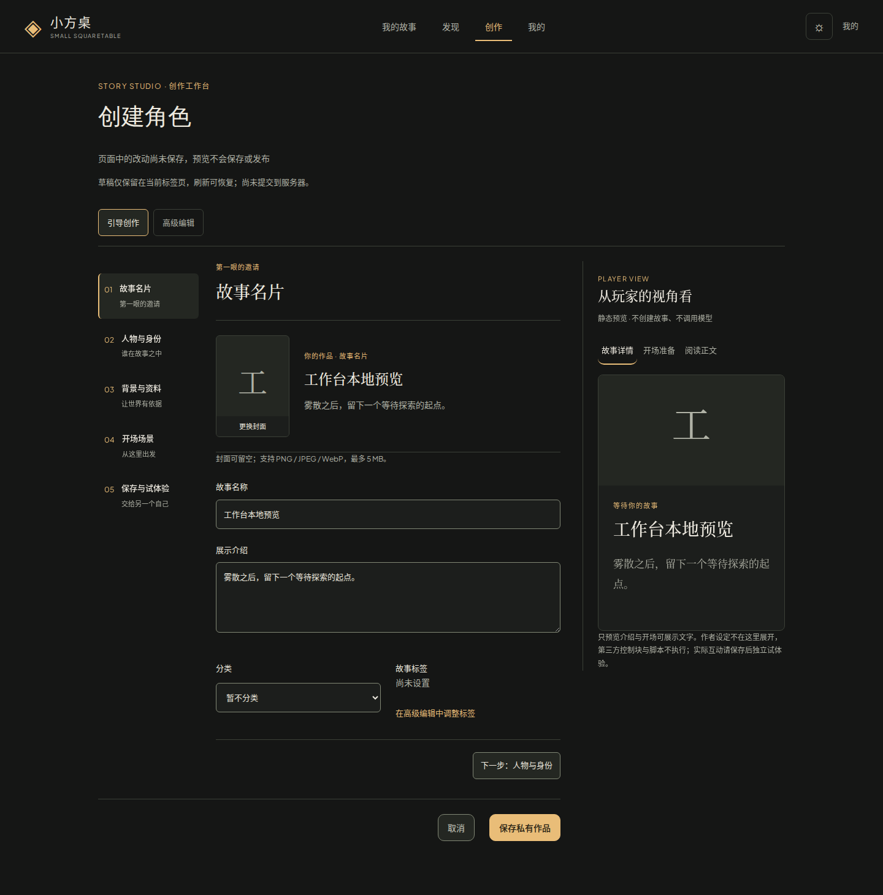
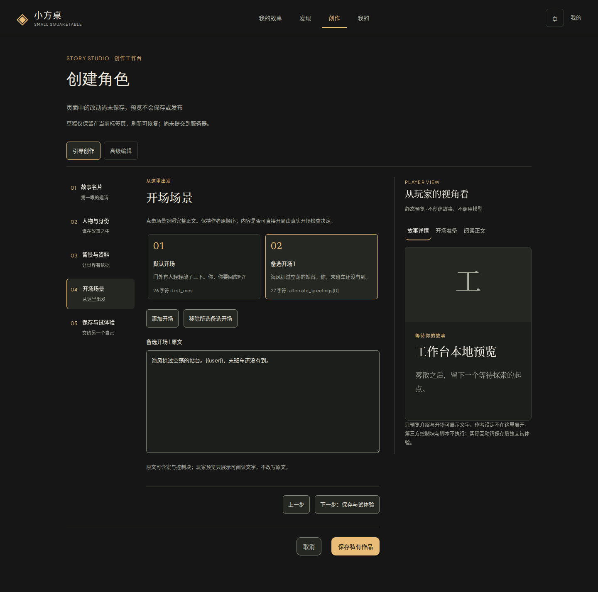
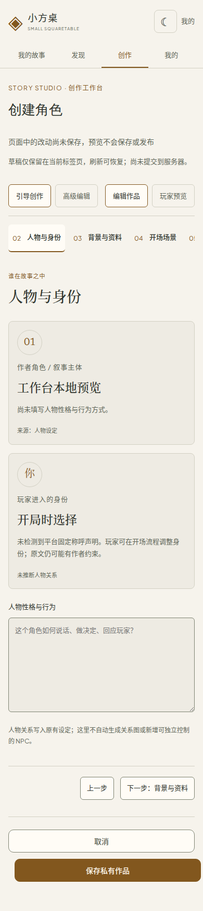
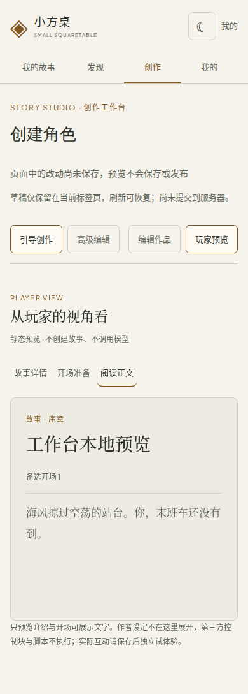

# 创作工作台：实际候选画面

2026-10-26，实际3081部署的合成本地草稿截图。没有保存或公开这张演示作品，不包含私人卡片正文；截图审阅不是用户视觉签收。

桌面故事名片：步骤、当前对象和玩家预览同时可见。

桌面开场场景：比较多个开场，保留原文编辑，右侧切换详情/开场准备/阅读预览。

手机人物编辑与玩家阅读分别呈现，使用编辑/预览按钮切换。

[实际效果与证据](../../product/creator-workbench-delivery-20261026.md) · [固定完成条件](../../product/creator-workbench-contract.md)
