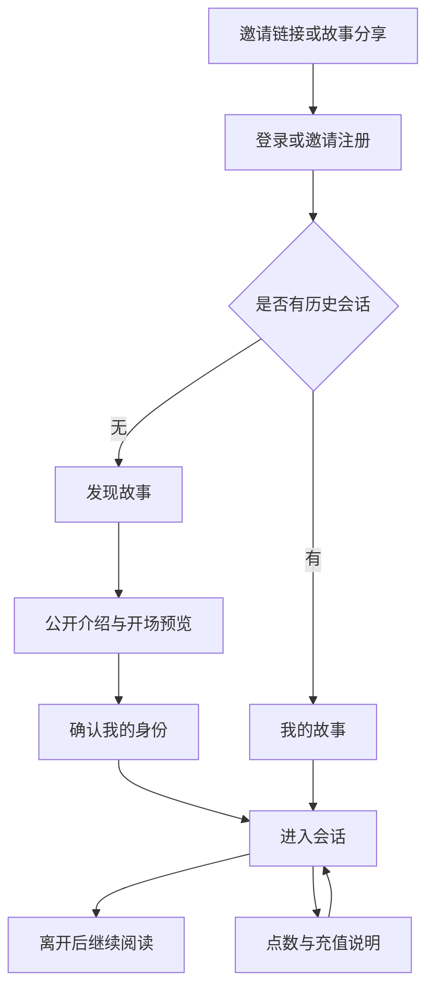

# Small Squaretable：互动故事与角色扮演体验设计

> 历史体验方案（2026-10-20）。最新已确认需求与待讨论边界见 [探索式体验决策基线](exploration-experience-baseline.md)；新页面见 [待讨论提案](../design/exploration-page-proposal.md)。本文的旧旅程、样板与具体建议不覆盖后续确认结果，也不证明探索系统已实现。

版本：1.0 · 日期：2026-10-20 · 状态：设计基线，待通过样板页面与用户试用验证。

用户已确认的方向是「互动故事与角色扮演」。本文将这一方向展开为可实施的体验方案；具体布局、指标和新增能力是设计提案，不代表已经上线。

关联文档：[产品定位](positioning.md)、[前端设计语言](../design/visual-language.md)、[活动待办](backlog.md)。本文细化体验定位，保留小圈子运营、平台提供模型接入、邀请码注册、按用量计费的产品边界。历史文档中的实现状态以当前代码和实际验收为准。

## 1. 产品主张与设计判断

**进入一个故事，扮演自己的角色，通过行动与对话推动情节。**

用户得到的核心价值是参与感、连续性和表达自由。角色卡是故事入口，世界书是背景依据，记忆帮助维持前后关系，模型负责回应。界面应当让用户理解自己正在参与什么，而无需先理解提示词工程。

| 设计原则 | 用户能感受到的结果 | 实施约束 |
|---|---|---|
| 情境先于参数 | 很快知道故事从哪里开始 | 首屏不展示温度、上下文长度等参数表 |
| 用户保有行动权 | 可以自己决定说什么、做什么 | 默认禁止提示词替用户完成关键选择；允许用户明确委托 |
| 阅读优先 | 长时间读写仍然舒适 | 独立阅读字号、有限行宽、稳定滚动 |
| 连续性可信 | 回来后能接上剧情 | 保留历史、草稿；回顾注明来源和范围 |
| 费用明确 | 知道可用余额、已扣费用和失败处理 | 费用信息以服务端账本为准 |
| 复杂度按需展开 | 新手直接开聊，老用户仍可调节 | 日常操作、阅读设置、创作配置分层 |

首版不增加剧情地图、任务奖励、关系数值、成就或固定结局体系。没有对应持久化与规则支持时，不以这些视觉元素暗示系统能力。

## 2. 用户与核心任务

| 用户 | 主要需求 | 成功条件 |
|---|---|---|
| 首次体验者 | 找到感兴趣的题材，知道自己如何参与 | 无需人工讲解即可发出第一条有意义的行动或台词 |
| 连续扮演者 | 延续角色关系与既有剧情 | 能找到上次会话，理解最近发生的事，继续输入 |
| 角色作者 | 定义情境、人物和开场，验证表现 | 预览与实际对话一致，更新不会意外暴露幕后设定 |
| 运营者 | 推荐内容、处理充值和问题反馈 | 可核对账户与账本，可区分模型失败和界面失败 |

首版优先优化前两类用户。创作与运营界面保持结构化表单，复用现有能力。

### 2.1 统一用语

| 用户用语 | 现有概念 | 语义边界 |
|---|---|---|
| 发现故事 | 角色市场 | 当前展示角色卡承载的情境；暂不创建独立 Story 领域模型 |
| 我的故事 | 聊天会话列表 | 一个会话是一段参与记录，同一角色可有多个会话 |
| 我的身份 | Persona | 用户的名字与扮演设定，可按会话选用 |
| 世界设定 | 世界书的可公开介绍 | 完整世界书仍是创作工具，不默认向玩家展开 |
| 前情回顾 | 会话摘要 | 自动整理内容可能遗漏，不能作为完整状态快照 |
| 已记住的经历 | 会话相关记忆 | 权限与现有会话隔离一致，不泄露其他会话 |
| 换一种回应 | 重新生成 | 是一次新的模型调用，可能产生费用 |
| 尝试另一种发展 | 消息分支 | 必须先说明原路线保留情况，不称为完整存档 |

模型仍称为「模型」。用户需要据此理解能力与费用，不用含义模糊的故事化词语替代。

## 3. 现有基础与设计增量

本表基于源码检查，不代表浏览器验收结果。

| 范围 | 当前基础 | 本轮设计增量 |
|---|---|---|
| 角色发现 | 市场、搜索、角色详情、收藏、导入 | 情境导向卡片、精选内容、回访入口 |
| 身份 | Persona 管理与选择 | 开场前的轻量身份确认 |
| 对话 | WebSocket 流式、消息编辑、分支、停止生成 | 阅读布局、完整状态反馈、明确恢复路径 |
| 上下文 | 世界书、记忆、情绪、摘要 | 玩家可读的入口、剧透边界、回顾来源 |
| 阅读外观 | 根节点主题、15/17/19px 字号、中文字体回落 | 页面一致性、字体选择提案、弱气泡样板 |
| 计费 | 点数余额、冻结、流水、管理员充值 | 从故事返回的充值路径、本轮结算状态 |
| 导航 | 多页面与模块开关 | 面向普通用户的四个主要目的地 |

新增故事标题、钩子、初始关系、封面焦点等展示字段需设计接口与导入兼容；不能假定现有字段都具有这些语义。前端可先用明确标记的设计 fixture 验证，生产数据缺字段时使用安全回退。

## 4. 信息架构与入口

普通用户一级导航建议为「我的故事 / 发现 / 创作 / 我的」。创作入口在移动端保留，但不抢占聊天操作空间。收藏归于发现，身份归于我的，世界书和预设归于创作或会话高级设置。管理员功能按权限进入独立区域。

| 目的地 | 复用路由 | 主要内容 |
|---|---|---|
| 我的故事 | `/chat` | 最近会话、继续阅读、新建入口、无历史引导 |
| 正在进行 | `/chat/:chatId` | 当前故事正文、输入、设置与恢复状态 |
| 发现 | `/market` | 搜索、题材筛选、角色情境卡、收藏入口 |
| 故事介绍 | `/characters/:id` | 公开介绍、开场预览、身份确认入口 |
| 创作 | `/my-characters` | 我的角色、导入、新建与编辑 |
| 我的 | 复用账户、身份、计费页面 | 阅读偏好、我的身份、点数、帮助 |

导航名称可以改变，首版尽量保留现有 URL。任何路由调整都应保留旧链接重定向。注册和充值返回地址只接受站内允许路径。



分享链接应优先恢复用户原本要进入的角色，不在注册成功后统一送回空首页。

## 5. 四条核心旅程

### 5.1 首次进入

1. 邀请落地页明确说明：这是 AI 互动故事、需要邀请注册、使用会消耗点数。
2. 注册完成后进入原目标角色；没有目标时展示少量编辑精选与搜索，不强制填写题材问卷。
3. 详情页回答「我是谁、会遇到谁、从哪里开始」。
4. 身份面板有可用默认值，只需确认；名字与设定可编辑，详细 Persona 配置按需展开。
5. 检查角色是否仍可访问、模型是否可用、计费模式和可用余额，再创建或进入会话。
6. 展示开场和两到三个作者提供的可选接话建议；选择建议只填入输入框，不自动发送。
7. 第一条输入成功持久化后才标记已发送；模型开始输出与消息保存是两个不同状态。

体验点数是运营决策，不默认承诺。若没有赠送点数，用户在开始前就能看见要求；未充值用户仍可阅读公开介绍和预览。

### 5.2 回访继续

我的故事顶部展示最近会话，包含角色、用户可编辑的会话名、最后活动时间和最近正文摘录。首版不为了填卡片而额外调用模型生成标题。

进入会话恢复上次阅读锚点；主动选择「到最新」才滚到底。前情回顾按需展开，标注「自动整理」及覆盖到的消息位置。摘要过旧时提示未包含最近内容。

本机草稿可作为首版恢复方案。存储键必须包含账户与会话，退出登录清理敏感缓存，存储不可用时不阻塞输入。跨设备草稿同步是后续能力，不在首版承诺中。

### 5.3 作者交付故事

作者完成公开介绍、人物设定、用户默认身份、开场和封面后，进入与实际聊天共用的预览组件。检查用户是否有接话空间，是否发生身份混淆，是否意外显示幕后提示词。

导入 ST 卡片时先显示导入结果：识别到的人物、开场、世界书、图片、未支持的扩展。保留原有字段，不自动以故事介绍覆盖角色名和描述。脚本或富文本内容遵循现有安全渲染边界。

公开介绍与模型使用的完整设定分离。旧卡片缺少公开情境时显示角色名称和安全简介；无法确定哪些字段可公开时只显示已知公开字段，不从完整提示词截取。

### 5.4 充值后继续

余额不足时保留输入内容和会话位置，展示「查看点数」入口。账户页列出可用点数、暂时冻结的点数、记录和运营者配置的充值说明。

用户提交付款凭证不等于到账。只有后台确认写入账本后刷新余额并允许继续。充值说明应含收款渠道、账户识别方式、预计处理时间和问题联系方式；运营者未配置时明确显示暂不可充值，不生成虚假的支付按钮。

首版不必创建在线订单系统。人工充值状态若无对应服务端记录，不展示「处理中」等伪进度。

## 6. 关键页面规格

### 6.1 发现页

首屏顺序：页面标题与搜索 → 有历史时的紧凑继续入口 → 题材筛选 → 故事卡片。精选是运营者可维护的内容集合；未建立精选数据源时使用真实列表，不以随机结果冒充推荐。

卡片内容：封面、故事钩子或角色名、一句公开情境、主要角色、最多三个标签。标题建议 8–20 个中文字符，允许最长两行；情境建议 30–60 字，超过时截断并在详情展示完整内容。长度是编辑建议，不应拒绝合法导入数据。

卡片主链接打开详情，收藏为独立按钮，避免嵌套按钮或嵌套链接。移动端首版单列横向卡，封面与文字分栏；宽屏按容器空间增加列数。图片失败用题材文字与中性色块回退，保持卡片高度稳定。

搜索保留输入、筛选与滚动位置。清空筛选是一键操作。没有结果时展示查询词、清空条件和导入角色入口；加载失败与没有结果分别表达。

### 6.2 故事详情

内容顺序为封面和标题、情境钩子、用户身份、主要角色与初始关系、公开背景、开场预览、内容标签、作者信息。世界书全文和系统提示词不属于玩家详情。

主操作优先级：有既有会话时显示「继续故事」，次操作「开始新的故事」；多会话时先列最近记录。没有会话时主操作「进入故事」。开始新会话不覆盖旧会话。

桌面可用封面与介绍双列；手机首屏显示适度裁切的封面、情境和主操作。底部吸附按钮必须给正文预留空间，并避开系统安全区。

角色被删除、改为私有或不可访问时关闭新建入口，明确原因的公开程度服从服务端权限策略。已有会话能否继续由服务端决定，前端不得因为有缓存而放行。

### 6.3 开场身份确认

用一个面板完成名字、简短身份、模型确认。已有 Persona 优先复用；缺省值来自作者的公开建议或用户自己的默认身份。用户确认前不写入全局默认偏好。

模型显示名称和已知能力；费用只展示有来源的规则。没有真实价格元数据时不贴「最省」「最佳」标签。高级参数折叠，不要求用户逐项配置。

提交中防重复点击；创建失败保留面板数据。若会话已创建而首轮生成失败，直接进入该会话处理失败，不再次创建一份。

### 6.4 故事阅读页

桌面布局示意，数值为样板建议，见设计语言的响应式规则：

```text
┌──────────────────┬──────────────────────────────────┐
│ 我的故事         │ 故事名 · 角色       模型  ···     │
│ 搜索 / 新建      ├──────────────────────────────────┤
│                  │                                  │
│ 最近会话         │     前情回顾（按需展开）         │
│ 会话 A           │                                  │
│ 会话 B           │     角色名                       │
│                  │     叙述与台词                   │
│                  │                                  │
│                  │     你的行动                     │
│                  │                                  │
│                  │     新内容 ↓                     │
│                  ├──────────────────────────────────┤
│ 我的 / 点数      │ 描述你的行动，或说出你的台词…    │
│                  │ 我的身份             发送 / 停止 │
└──────────────────┴──────────────────────────────────┘
```

手机布局：

```text
┌──────────────────────────────┐
│ 返回    故事名          ···  │
├──────────────────────────────┤
│ 前情回顾                     │
│                              │
│ 角色名                       │
│ 叙述与台词                   │
│                              │
│ 你                           │
│ 你的行动                     │
│                    新内容 ↓  │
├──────────────────────────────┤
│ 描述你的行动…                │
│ 我的身份              发送   │
└──────────────────────────────┘
```

正文采用弱气泡的阅读排版：助手文本自然铺在阅读区域，用户文本通过姓名、边界或轻背景区别。多角色会话每次发言都显示角色名，不能仅靠头像或颜色辨认。消息内部不自动猜测谁在说话。

消息工具包括编辑、复制、换一种回应与更多操作。桌面 hover 和键盘 focus 均可显示；手机始终有可发现的更多按钮，不把长按设为唯一入口。保留文本选择与系统复制行为。

停止生成在输出期间位于发送按钮位置，带「停止」可访问名称。停止后保留已收到内容，明确这段回复未完成。不得将未完成回复伪装成完整结局。

生成中默认不允许同一会话再次提交；草稿仍可编辑。用户可切换页面，但后台生成是否继续应依据真实连接生命周期提示，不承诺离开后一定完成。

### 6.5 我的故事

每条记录显示标题、角色、时间、摘录；最近记录优先。切换角色与切换会话的概念要分清。同一角色开启两段故事时均有独立条目。

删除会话需确认并说明影响。没有服务端恢复能力时不展示「撤销删除」。新建、改名、删除、导出沿用现有接口权限。

空状态：「你的第一段故事还没有开始。」主操作「发现故事」，次操作「导入角色」。不展示无意义的统计零值。

### 6.6 创作页

基础编辑建议分为「公开介绍 / 人物与开场 / 世界与进阶」三组。公开介绍旁明确哪些内容会出现在发现页；幕后设定与作者备注采用单独字段或显式可见性标记。

侧边预览复用真实卡片和正文渲染组件。试聊产生用量时在开始前告知，不把试聊隐含为免费。保存失败保留编辑内容；离开时有未保存修改则确认。

新建内容的建议最低质量标准：有明确情境、用户身份、角色目标、可回应的开场，至少人工试聊三轮。字段填满不等于内容已经可用。

## 7. 对话状态与异常恢复

消息持久化、模型生成、点数结算分别建模。前端不能用一个 `loading` 同时表示三者。

| 状态 | 显示与可操作项 | 数据与费用要求 |
|---|---|---|
| 草稿 | 可编辑，发送可用 | 不宣称已保存到服务器 |
| 提交中 | 当前输入显示发送中，禁止重复提交 | 需要服务端确认后才标记成功 |
| 已保存，等待响应 | 显示「正在准备回应」，可停止 | 不显示虚假百分比或推理步骤 |
| 正在输出 | 增量正文，停止可用 | 费用尚未最终确定 |
| 已完成 | 回复与消息工具 | 单次费用有权威数据时再展示 |
| 用户停止 | 保留部分文本，标记「已停止」 | 按实际发生的用量规则结算，不能承诺免费 |
| 连接中断 | 保留正文和草稿，提供重新连接 | 恢复后先查询已有消息，避免重复生成 |
| 明确失败 | 显示可读原因和可用操作 | 是否扣点依据账本，不依据界面报错推断 |
| 余额不足 | 保留草稿，查看点数 | 不自动降级模型或自动缩短上下文 |
| 结算未确认 | 「消耗正在核对」，允许查看记录 | 不把未知费用显示为 0 点 |

等待文案建议阈值：超过 8 秒增加「响应时间较长，你可以继续等待或停止」；这只是前端提示阈值，不代表服务端超时，也不证明模型故障。

### 7.1 重试与幂等

网络失败后先对账：查找已保存的用户消息与助手消息，确认生成是否仍在进行。不得自动重放会产生费用的请求。用户主动重试时说明可能开始一次新生成。

如果服务端没有请求标识、生成状态查询或可恢复流能力，首版提供「重新连接并检查记录」，明确不能恢复丢失的流片段。完整恢复是后续接口工作包，不能仅凭前端按钮宣称实现。

### 7.2 滚动与阅读位置

- 用户处于底部附近时才自动跟随输出，建议阈值 80px，待实测调整。
- 用户主动向上滚动后停止跟随，显示「有新内容」按钮。
- 向上加载历史时以首个可见消息 ID 与偏移保持锚点，不跳到列表开头。
- 封面、头像和媒体预留尺寸，字号变化后尽量保持同一消息可见。
- 输入法组合期间按 Enter 不触发发送；桌面 Enter 发送、Shift+Enter 换行，手机 Enter 默认换行，显式按钮发送。

### 7.3 分支、编辑与剧情连续性

现有消息分支不自动等于完整世界状态回滚。记忆、摘要、情绪和用户身份是否随分支恢复需要服务端明确策略。

首版保留现有分支操作名称和范围说明，未验证完整隔离前不宣传「回到任意时间点」。编辑历史消息若会影响后续内容，应先说明影响范围，再由用户确认；不能静默丢弃后续内容或承诺全自动重算。

## 8. 故事内容与扮演边界

推荐开场结构：地点或时间 → 发生中的冲突 → 角色向用户留下回应空间。建议 150–350 个中文字作为内容样板的编辑范围，不作为硬性接口限制。

样板：《最后一班列车没有终点》。公开情境为「午夜上车后，你发现检票员知道你的名字」；用户身份为晚归乘客，初始关系为陌生人。示例接话建议：「问他为什么认识我」「先观察其他乘客」「递出车票」。全部为设计样例，不代表已发布角色。

内容质量规则：

1. 角色可尝试影响用户，但关键行动、同意和情绪由用户决定；用户明确要求代演时例外。
2. 记录用户已经做出的选择，避免同一问题反复询问。
3. 不把每轮回复都写成大段背景说明或强制悬念。
4. 开场建议优先作者提供；若后续由模型生成，应说明成本、延迟并允许关闭。
5. 题材标签描述实际内容；内容偏好继续遵守平台开关与服务端用户偏好。
6. 玩家可见的世界介绍和记忆记录不包含幕后秘密；公开与隐藏字段的边界需要服务端裁剪，不能只靠 CSS 隐藏。

前情回顾需要显示「自动整理，可能遗漏」；没有人工修订接口时提供回到原消息的路径，不显示不可用的编辑按钮。

## 9. 费用与运营体验

日常展示点数，详情展示 token、模型、计量方式和时间。按当前规则显示费用，所有示例点数仅用于排版 fixture，不构成定价。

| 场景 | 推荐文案 | 条件 |
|---|---|---|
| 已结算 | 本次消耗 0.6 点 | 服务端已给出对应生成或消息的结算结果 |
| 估算 | 预计消耗约 X–Y 点，以实际用量为准 | 有可靠上下文与模型参数，说明估算依据 |
| 结算中 | 本次消耗正在核对 | 生成完成但没有最终账本信息 |
| 余额不足 | 可用点数不足，输入内容已保留 | 确认草稿确实保留 |
| 已停止 | 已停止生成，已产生的用量仍可能计费 | 与实际计费规则一致 |
| 充值到账 | 已增加 X 点，可返回故事继续 | 账本写入成功后展示 |

当前用户端已有规则说明，涉及不过期、不退款及错误扣费冲正。设计阶段沿用实际配置和规则；变更须由运营者明确并同步用户文案，不能在视觉改版时改变承诺。

生成成功但结算失败，需要运营者能查询异常。前端不能通过先显示扣费再回滚的动画制造与账本不一致的余额。

## 10. 前端与接口衔接

优先复用既有 Pinia、API 服务层和 Vue 组件。新组件名是提案，最终拆分以职责为准。

| 体验职责 | 当前入口 | 拟调整方式 |
|---|---|---|
| 故事发现 | `Market.vue`、`CharacterCardImmersive.vue` | 增加展示映射与卡片内容层级 |
| 故事介绍 | `pages/CharacterDetail.vue` | 区分公开介绍与幕后设定，增加继续入口 |
| 空会话与回访 | `WelcomePage.vue`、`ChatSidebar.vue` | 首次推荐与最近故事两种状态 |
| 阅读与输入 | `ChatWindow.vue`、`MessageBubble.vue`、`MessageInput.vue` | 提取阅读区、输入区与状态提示职责 |
| 身份与设置 | `PersonaSelector.vue`、`CharacterTuner.vue` | 默认可用，进阶展开 |
| 阅读偏好 | `ChatFontSizeSetting.vue`、`useChatFontSize.ts` | 复用现有字号，字体选择另行实现 |
| 点数 | `CreditsBalance.vue`、`credits.api.ts` | 复用余额流水，新增关联生成的展示需接口支持 |

建议的前端状态边界：会话 ID、当前角色、选定身份、消息、草稿、生成状态、连接状态和结算状态各自明确；正文组件只渲染，不自行发起模型调用或扣费请求。

建议的展示模型包含 `characterId`、`displayTitle`、`hook`、`publicPremise`、`initialRole`、`initialRelationship`、`coverUrl`、`coverFocus`、`tags`、`openingPreview`。字段为提案，未绑定现有数据库 schema；旧卡片以 `name` 和经过权限确认的公开字段回退。

上线前必须确认的接口缺口：生成标识及状态查询、消息与账本关联、公开介绍字段、分支状态语义、草稿保存范围。缺少其中任一能力时，按本文的降级行为呈现，不伪造数据。

## 11. 性能、可访问性与隐私

- 主要操作点击后 100ms 内出现本地反馈是设计目标；模型首字耗时单独记录，不归咎于界面。
- 目标指标为移动端真实用户 p75 LCP ≤ 2.5s、INP ≤ 200ms、CLS ≤ 0.1；目前未采集新的基线，不声称已达到。
- 封面使用响应式图片和预留比例；首屏关键图优先，其余懒加载。聊天页不预加载全市场大图。
- 长历史使用分页；是否引入虚拟列表由测量决定，并验证文本选择、屏幕阅读器与锚点恢复。
- 正文不逐 token 触发屏幕阅读器播报，使用独立的状态提示区域；完成时提供可定位的新回复。
- 支持键盘、200% 缩放、减少动态效果、触控及无 hover 操作；具体尺寸见设计语言。
- 分析事件不携带聊天正文、Persona 内容、世界书或支付凭证；本地存储的草稿按账户隔离，登出清理。

## 12. 样板与用户验证

先制作一个真实结构的样板，再扩展全站。主样板为都市悬疑，另以奇幻冒险和日常关系两组内容检查视觉是否过度依赖某一题材。

样板应涵盖：发现列表、详情、身份确认、完整会话、生成中、停止、中断、余额不足、回访回顾、点数页面，以及没有封面和超长标题的边界情况。

邀请 5–8 位目标用户进行形成性测试，包含新手与有 ST 经验的用户。这是发现问题的小样本，不用于宣称统计显著提升。

| 任务 | 观察点 | 初始验收目标 |
|---|---|---|
| 找到并开始故事 | 是否理解情境与自己的身份 | 至少 4/5 位无需提示完成 |
| 发出首条行动 | 是否知道输入动作或台词 | 已登录且有余额时，中位耗时 ≤ 2 分钟 |
| 连续聊十轮 | 是否误触、阅读疲劳、输入框遮挡 | 无阻断问题，全部问题记录归因 |
| 中断后返回 | 是否重复发消息或丢失草稿 | 每例都能解释消息与生成的最终状态 |
| 查看一次消耗 | 是否区分可用、冻结、已消费 | 至少 4/5 位能用自己的话解释 |
| 回访续聊 | 是否找得到原会话与最近进展 | 无需从发现页重新寻找角色 |

可选事件：`story_detail_opened`、`session_created`、`first_turn_completed`、`generation_stopped`、`generation_failed`、`session_resumed`、`credits_viewed`。仅在已有可用的最小观测渠道登记；不为这些指标重新启用 Kafka/Flink 分析体系。事件字段限于获准的标识、状态、时长与错误类别。

## 13. 分阶段交付

下列工作包是建议顺序，尚未开始编码。实施前纳入活动待办，沿用现有任务 ID，避免建立平行的活动任务清单。

| 阶段 | 交付内容 | 验收门槛 |
|---|---|---|
| A：设计样板 | 一套发现/详情/阅读样板，暗浅主题，状态 fixture | 设计语言一致，字段来源清楚，无虚构能力 |
| B：首次与回访 | 故事化导航、开场身份、继续故事、草稿 | 首次进入与回访任务通过 |
| C：可靠对话 | 流式状态、滚动、停止、失败恢复、结算反馈 | 真实后端完整闭环通过 |
| D：作者与运营 | 公开介绍编辑、导入反馈、充值返回路径 | 作者可交付一个合格角色，运营可核对费用 |
| E：有限试用 | 目标用户试用、问题归因、修订 | 阻断问题解决，有回滚方案和支持入口 |

每阶段交付包含：对应页面和组件、状态清单、接口约定、验收记录、已知限制。截图只能证明外观；真实闭环应另有验证记录。

## 14. 前端交付验收矩阵

| 类别 | 必验项目 |
|---|---|
| 视口 | 360、390、768、1024、1440px；另在 320px 检查重排和横向溢出 |
| 设备 | iOS Safari、Android Chrome 真机键盘；桌面 Chrome、Safari 或目标用户常用浏览器 |
| 主题 | 首帧、暗浅切换、刷新、系统明确浅色、存储不可用、teleport 弹层 |
| 文本 | 中文长文、英文长词、混合台词、Markdown、长链接、超长名字、无封面 |
| 输入 | 中文输入法、换行、重复点击、草稿切换、键盘收起、余额不足 |
| 生成 | 等待、正常完成、用户停止、模型失败、断网重连、结算未确认 |
| 导航 | 分享后登录返回、浏览器后退、返回列表滚动、已有与多个会话 |
| 权限 | 私有或删除角色、未登录、过期登录、账户切换、内容偏好 |
| 可访问性 | 键盘顺序、焦点恢复、可访问名称、对比度、200% 缩放、减少动态效果 |
| 费用 | 正常扣费、停止后的实际计费、失败对账、重复请求、人工充值到账 |

需要保留三类证据：组件和页面状态截图、交互测试结果、真实服务链路记录。现有 mock E2E 不替代真实链路验收。

## 15. 保留的技术开发建议

本节保留此前项目分析的建议，不表示问题已经修复。以下编号仅供本文引用，实施时登记到活动待办。

| 编号 | 建议 | 与体验的关系 | 验收方式 |
|---|---|---|---|
| T1 | 补齐迁移登记，验证空库安装与旧库升级 | 新环境不缺角色、邀请码、点数等表或字段 | 在隔离数据库执行升级，对照 schema、自定义索引与触发器 |
| T2 | 修复生产镜像启动与迁移依赖，核对 pgvector 和生产配置 | 用户拿到可运行的交付物 | 构建镜像，启动服务，执行迁移并验证健康与核心请求 |
| T3 | 分离限流策略的键与窗口，修正等待秒数 | 正常浏览不会挤占登录额度 | 不同策略独立计数，响应等待时间符合窗口 |
| T4 | 修正公开路由参数匹配，集中资源授权规则 | 公开详情可访问，私有内容受保护 | 公开、未登录、跨用户和失效资源请求测试 |
| T5 | 明确单实例基线；扩容前补跨实例消息与任务协调 | 通知、生成状态与后台任务一致 | 单实例试用；多实例另设同步与防重复验收 |
| T6 | 增加真实注册→导入→生成→停止→结算闭环 | 故事体验与费用可被实际验证 | 隔离测试账户和数据库，核对消息与账本 |
| T7 | 分职责拆分大型聊天组件和路由 | 降低视觉迭代引入回归的概率 | 先锁定现有行为，再以相同用例验证拆分 |
| T8 | 同步环境模板与产品文档 | 运营者不会误用订阅模式或错误环境文件 | 从项目自身模板部署并核对生效配置 |

T1–T4、T6 与对外试用直接相关，应优先于纯装饰改版；视觉样板可以并行。资源查询只带用户 ID 不足以判定越权，需结合用户归属和服务层校验；这一点不能在后续任务中误写成已确认漏洞。

## 16. 尚需验证的选择

| 选择 | 本文默认方案 | 何时调整 |
|---|---|---|
| 阅读布局 | 助手弱气泡，用户有轻量身份边界 | 用户试用无法辨认发言者时加强分隔 |
| 字体 | 沿用现有阅读字体栈与字号 | 真机中文阅读反馈不佳时提供无衬线选项 |
| 首次体验点数 | 不默认承诺赠送 | 运营者明确额度、成本与滥用处理后配置 |
| 封面背景 | 封面强调氛围，正文默认纯色 | 完成对比度与性能验证后开放可选背景 |
| 剧情分支 | 保留现有消息分支，不声称完整回滚 | 记忆、摘要、情绪的隔离语义验证后扩展 |
| 自动接话建议 | 首轮作者提供，点击只填入 | 证明用户需要持续建议且有预算后增加生成 |

本文的设计目标通过样板、真实链路与用户观察验证。状态、费用和权限表达必须服从真实行为；视觉表达不能先于功能承诺。
